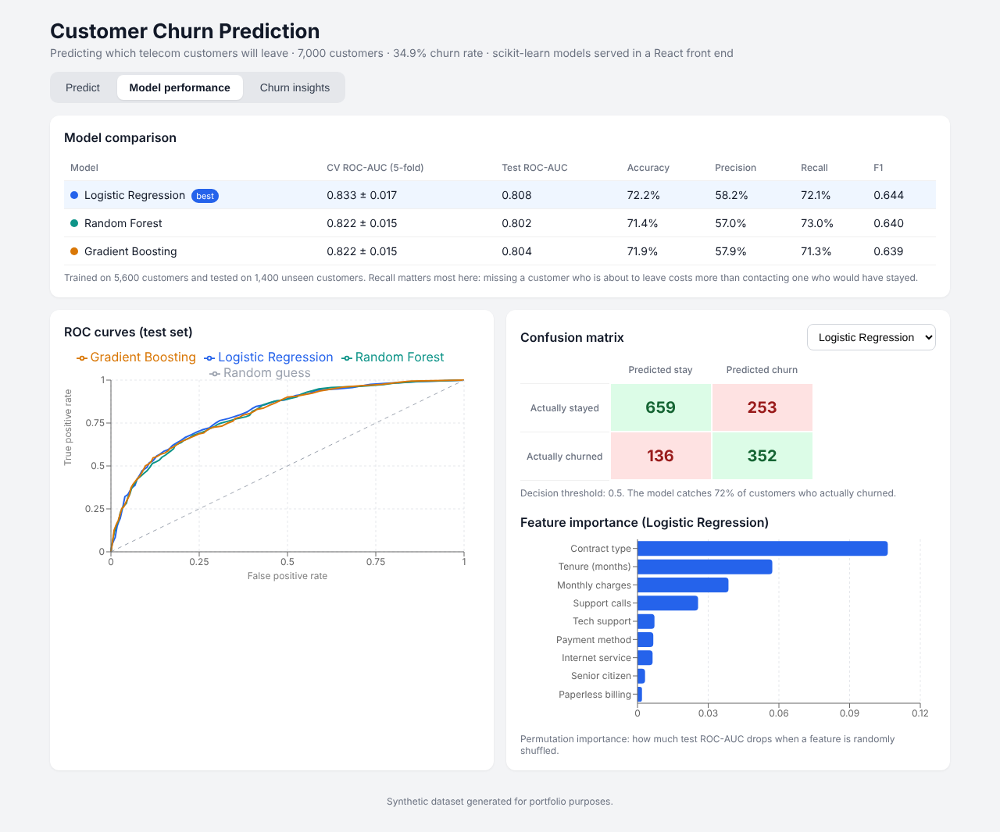

# Customer Churn Prediction

**Live demo:** https://kushsharawat.github.io/churn-prediction-app/

A machine learning project that predicts which telecom customers are likely to leave. It **trains and compares three scikit-learn models in Python** and presents the results in an interactive **React** app, including a live predictor that scores any customer in the browser and explains why.


## Features

**1. Live churn predictor.** Adjust a customer's tenure, contract, monthly charges, support calls and more. The app instantly shows:
- the churn probability and a risk band (low, medium or high)
- a suggested retention action
- a chart of which features push this customer's risk up or down

**2. Model performance.** Compares Logistic Regression, Random Forest and Gradient Boosting on:
- 5-fold cross-validated ROC-AUC
- test-set ROC-AUC, accuracy, precision, recall and F1
- ROC curves, confusion matrices and permutation feature importance

**3. Churn insights.** Exploratory analysis of churn by contract, tenure, support calls and payment method, with business recommendations.



## Results

| Model | CV ROC-AUC | Test ROC-AUC | Recall | F1 |
|---|---|---|---|---|
| **Logistic Regression** | **0.833 ± 0.017** | **0.808** | 72.1% | **0.644** |
| Random Forest | 0.822 ± 0.015 | 0.802 | 73.0% | 0.640 |
| Gradient Boosting | 0.822 ± 0.015 | 0.804 | 71.3% | 0.639 |

Logistic Regression performed best. It is also the easiest model to explain to a business audience, so it powers the live predictor.

**Key findings**
- **Contract type is the strongest driver.** Month-to-month customers churn at 52%, compared with 8% on two-year contracts.
- **The first 6 months are the riskiest:** 65% of those customers churn, falling to 6% after 4 years.
- **Each extra support call raises churn risk.** Churn more than doubles from 0 calls to 4 or more.

**Recommendation:** target month-to-month customers in their first year with contract upgrade offers, and contact anyone with 3+ support calls proactively.

## How it works

```
data/generate_customers.py  ->  data/customers.csv
ml/train_models.py          ->  web/src/data/results.json  ->  React app
```

1. **Preprocessing:** a scikit-learn `Pipeline` with a `ColumnTransformer` (StandardScaler for numeric features, OneHotEncoder for categorical ones)
2. **Validation:** a stratified 80/20 train/test split plus 5-fold stratified cross-validation
3. **Class imbalance:** handled with `class_weight="balanced"`, because recall on churners matters most
4. **Explainability:** permutation importance and logistic regression coefficients
5. **Deployment in the browser:** the trained model's scaler means, coefficients and intercept are exported to JSON, and `web/src/predictor.js` re-implements the pipeline in JavaScript. The output was verified to match scikit-learn's `predict_proba` to within 1e-15.

## Tech stack

| Layer | Tools |
|---|---|
| Machine learning | Python, scikit-learn, pandas, NumPy |
| Front end | React, Vite, Recharts, CSS |

## How to run

```bash
pip install -r requirements.txt
python data/generate_customers.py
python ml/train_models.py

cd web
npm install
npm run dev        # open http://localhost:5173
```

## About the data

The dataset is **synthetic**. `data/generate_customers.py` generates 7,000 customers whose churn follows realistic business patterns plus random noise, so the models learn a genuine but imperfect signal.

## Possible next steps

- Train on a real public dataset (e.g. the IBM Telco Customer Churn dataset on Kaggle)
- Tune hyperparameters with `GridSearchCV` and try XGBoost
- Add SHAP values for richer explanations
- Serve the model from a FastAPI back end instead of in the browser
- Deploy to Vercel or GitHub Pages
